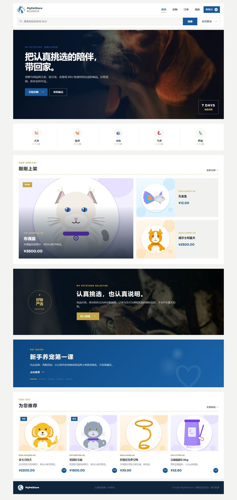
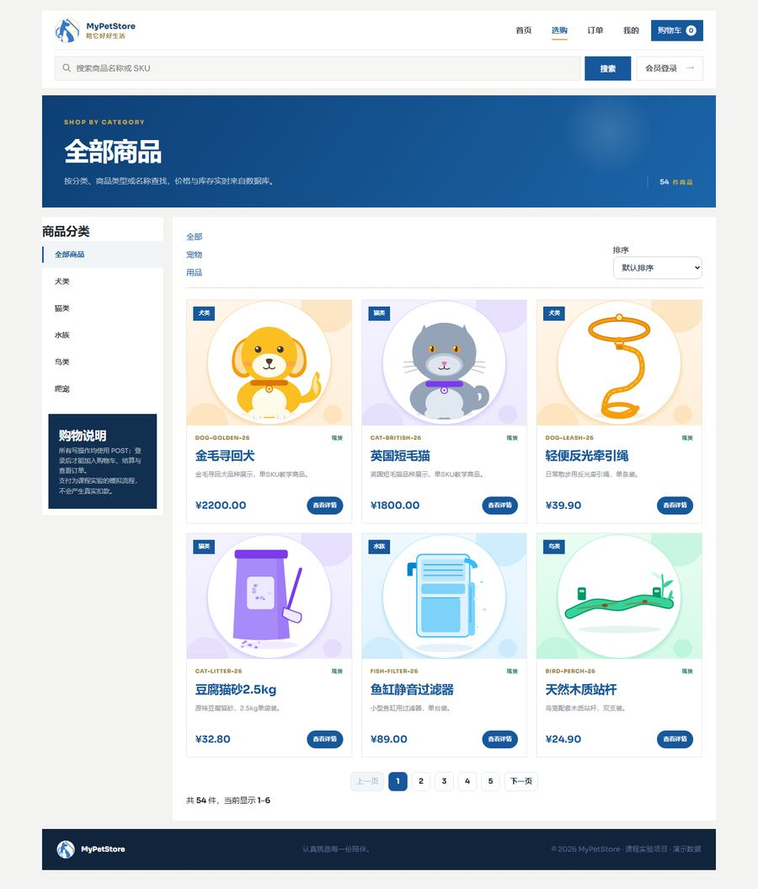
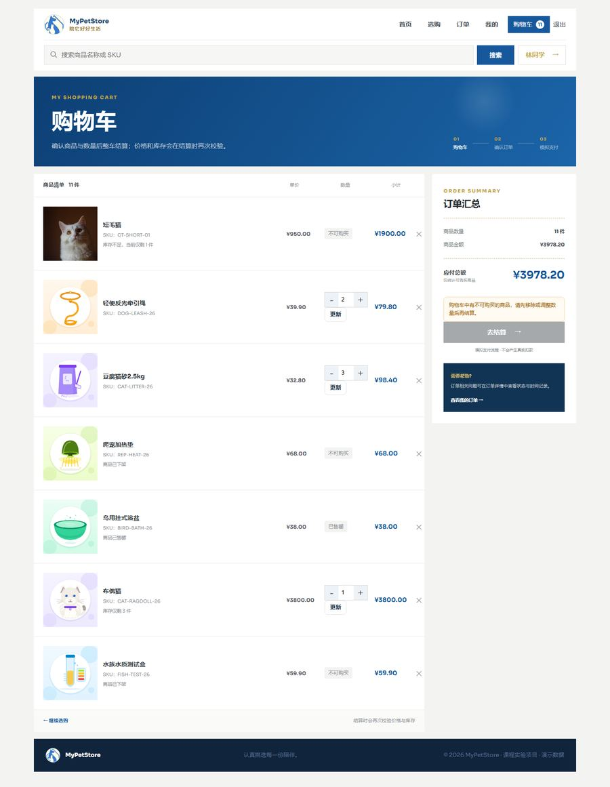
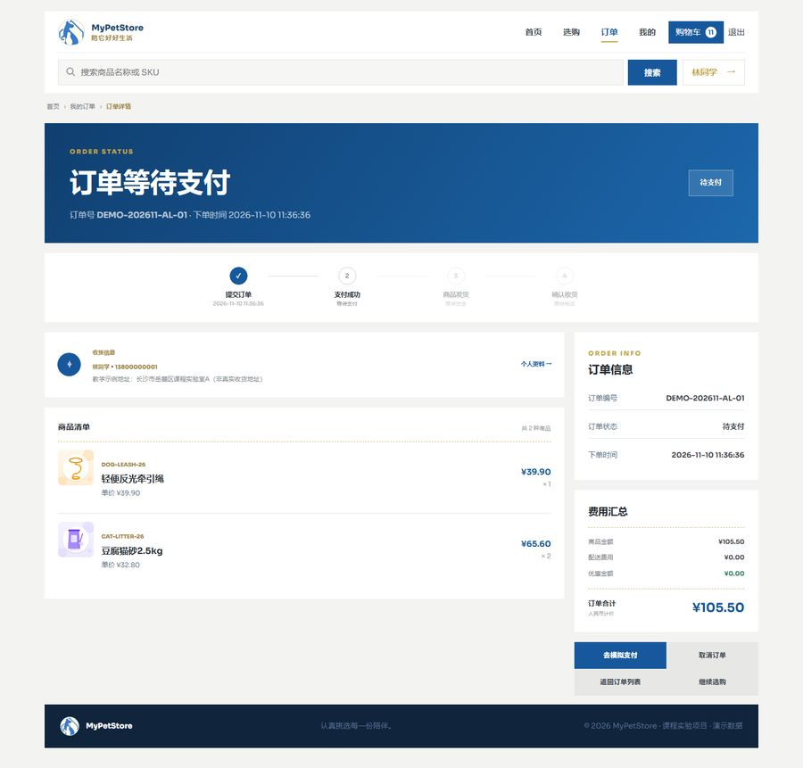

# 视觉验收

> 目的：把「页面长什么样」变成可复查的产物。早期版本没有截图验收，`rendered/` 是空目录，
> 交付时没人真正看过渲染结果，于是「字体没加载」「占位图比正文还大」这类问题一直没被发现。

## 1. 验收方式

`scripts/capture-pages.mjs` 用系统自带的 Edge/Chrome 以无头模式启动浏览器（走 CDP 协议，零第三方依赖），
逐页整页截图，覆盖未登录、已登录、购物车、结算、订单、个人资料与管理端主要页面。

```bash
# 前提：MySQL 已导入 database/02-schema-with-demo.sql；8080、8081 已启动；桌面已装 Edge 或 Chrome
node scripts/capture-pages.mjs rendered
```

脚本会自己拉起浏览器、按 1440px 视口渲染、等 `document.fonts.ready` 之后再截图，
最后关闭浏览器并清理临时 profile。截图文件按序号命名，可直接贴进实验报告。

演示账号：`alice` / `bob` / `admin`，统一密码 `PetStore123!`。

- `alice` 的购物车故意混入下架、售罄、库存不足的商品，用于演示「不可结算商品」拦截；
- `bob` 的购物车全部可结算，用于演示购物车 → 确认订单 → 模拟支付的完整主流程。

## 2. 本轮定位到的问题与修复

按影响从大到小：

| # | 现象 | 根因 | 修复 |
| --- | --- | --- | --- |
| 1 | 全站排版「没有设计感」，标题没有气势、层次扁平 | `jpetstore.css` 声明 `font-family: "Sora", …`，但工程里既没有 `@font-face` 也没有 `fonts/` 目录，Windows 上实际回退到 Segoe UI；设计稿的字体度量全部失效 | 下载 Sora / Plus Jakarta Sans 可变字重 woff2 到 `static/fonts/`，新增 `fonts.css`，两端 `layout.html` 在业务 CSS 之前引入 |
| 2 | 首页 hero 是一块深蓝色空板，没有图片 | 参考稿是 `<section class="home-hero">` + 遮罩 + 角标，模板把 `` 丢了 | `Main.html` 按参考稿重写：hero 实拍图 + 遮罩 + `7 DAYS` 角标，分类条、1 大 2 小新品卡、严选横幅、达人条、推荐四宫格 |
| 3 | 登录页/入口页出现「满屏平铺的小狗动图」 | 模板把 100×100 的 `dog1.gif` 当 `background-image` 用，没设 `background-size`，又缺少参考稿的 `.account-login-shade` | 改成参考稿的 `` 结构 + 真实商品照片，配 `.account-login-shade` 渐变遮罩 |
| 4 | 商品卡片是「大字 + SKU」的文字占位卡，看起来像没有图片 | 40 个演示 SKU 的封面是早期自动生成的文字卡片 SVG（1.7 KB，只有 `<text>`） | 新增 `scripts/generate_product_art.py`，生成 800×800 扁平插画：按犬/猫/鸟/鱼/爬宠五族配色，用品沿用所属家族配色，无文字、无位图、无外部引用 |
| 5 | 购物车商品行图片压住商品名，数量按钮竖着排 | 参考稿 `.cart-product` 是三列网格（勾选列 + 128px 图 + 文案），本工程没有勾选功能，图片被塞进 20px 列 | `app.css` 覆盖为两列；`cart-line-warning` / `cart-unavailable` / `cart-invalid-note` 补样式 |
| 6 | 商品详情缩略图是巨大的蓝色方块，溢出到第二行 | CSS 里没有 `.detail-thumb` 规则，按钮吃全局 `button` 背景；主图又被隐式网格挤列 | 图库改用参考稿的 `.product-gallery--store` + `.detail-media` + `.thumb-btn` 结构 |
| 7 | 订单详情底部操作按钮互相重叠 | 设计稿 `.order-detail-actions` 是两列 grid，`app.css` 旧规则把 `display` 改成 flex，`grid-template-columns` 仍生效 | 删掉 flex 覆盖，表单用 `display: contents` 让按钮直接成为网格项 |
| 8 | 订单卡片缩略图全是放大的 logo | `OrderRow` 没有封面字段，模板只能回退到 `logo.png` | mapper 增加 `cover_image_snapshot` 子查询，`OrderRow.coverImage` 绑定首件商品封面快照 |
| 9 | 购物车/订单/商品详情/账户页整体错位 | 模板 `<body>` 缺页面级 class，主体缺 `.mpa-shell xxx-shell` 外层，设计稿大量选择器选不中 | 逐页按参考稿补齐 body class 与 shell，DOM 结构与设计稿对齐 |
| 10 | 结算页、支付页宽度与其他页面不一致 | 这两页是本工程新增的，没有套 `.mpa-shell` | 补 shell，结算步骤条改用设计稿的 `.cart-steps` |

## 3. 逐页结果

截图在 `docs/screenshots/`（900px 宽 JPEG，原始整页 PNG 由脚本生成，不入库）。

| 页面 | 路由 | 截图 |
| --- | --- | --- |
| 入口页 | `/` | [index.jpg](screenshots/index.jpg) |
| 首页 | `/main` | [home.jpg](screenshots/home.jpg) |
| 全部商品 | `/category` | [category.jpg](screenshots/category.jpg) |
| 商品详情 | `/product/{id}` | [product.jpg](screenshots/product.jpg) |
| 登录页 | `/login` | [login.jpg](screenshots/login.jpg) |
| 购物车 | `/cart` | [cart.jpg](screenshots/cart.jpg) |
| 确认订单 | `/checkout` | [checkout.jpg](screenshots/checkout.jpg) |
| 订单列表 | `/orders` | [orders.jpg](screenshots/orders.jpg) |
| 订单详情 | `/orders/{id}` | [order-detail.jpg](screenshots/order-detail.jpg) |
| 个人资料 | `/profile` | [profile.jpg](screenshots/profile.jpg) |
| 管理端控制台 | `/dashboard` | [admin-dashboard.jpg](screenshots/admin-dashboard.jpg) |

### 首页



### 全部商品



### 购物车



### 订单详情



验收要点（与参考稿并排比对的部分）：

- **字号阶梯**：hero `clamp(2.5rem, 4.3vw, 3.4rem)`、区块标题 2.25rem、卡片标题 1.5rem 三档清晰；
  Sora 生效后标题的 `letter-spacing: -0.045em` 才有意义，中文回退到微软雅黑但字号/字重继承不变。
- **卡片间距**：`new-grid` 1.4fr / 1fr、`recommend-grid` 四列、`category-strip` 五等分，与参考稿一致。
- **按钮高度**：主按钮 46px、次级 44–48px、数量步进 34px，纵向对齐。
- **导航字距**：顶栏 `.nav-link` 与 `.brand` 的字重/字距在字体加载前后差异最明显，是判断字体是否生效的快速标志。

## 4. 仍未覆盖的部分

- 只做了 1440px 桌面视口；设计稿有 900px / 640px 断点，未逐页截图核对。
- 未做跨浏览器比对（只在 Edge 157 上验证）。
- 交互态（hover、focus、禁用、flash 提示）只抽查了登录失败与购物车「不可结算」提示，没有逐项截图。
- 管理端沿用自有的 `admin.css` 设计体系，只统一了字体，未按用户端设计稿改造。
